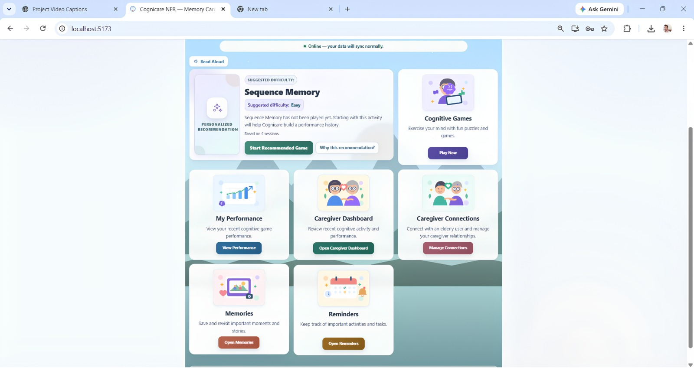
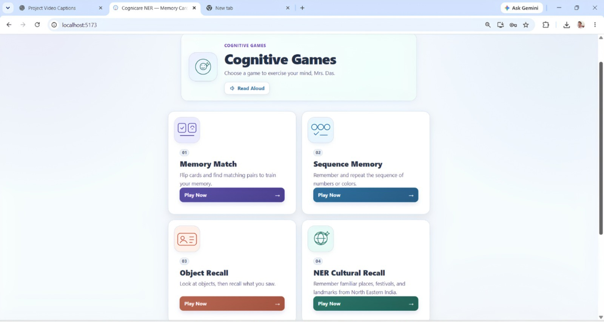
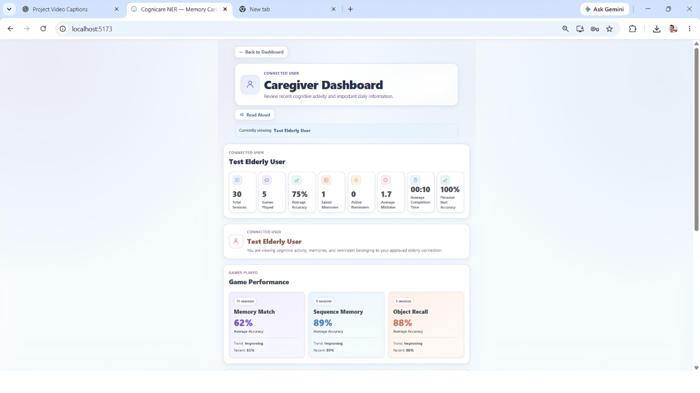

# 🧠 Cognicare NER

<p align="center">
  
</p>

<p align="center">
  <strong>AI-Based Cognitive Gaming and Memory Assistance Platform</strong>
  <br>
  <em>Supporting elderly users through cognitive engagement, memory assistance, and accessible technology.</em>
</p>

<p align="center">
  <strong>Team NeuroCare</strong>
  <br>
  Hackathon Prototype • Healthcare • Assistive Technology • Cognitive Support
</p>

---

## 🎥 Project Demo

<p align="center">
  <a href="Cognicare_NER_demo_video.mp4">
    <strong>▶️ Watch the Cognicare NER Demo Video</strong>
  </a>
</p>

The demo video showcases the Cognicare NER prototype and its user-facing features.

> **Note:** The video link points to the MP4 file in the repository root. GitHub may display the video differently depending on the file and browser. For a more convenient streaming experience, you can also upload the video to a supported video-hosting platform and link it here.

---

## 📌 Table of Contents

- [Overview](#-overview)
- [Problem Statement](#-problem-statement)
- [Our Solution](#-our-solution)
- [Key Features](#-key-features)
- [Application Modules](#-application-modules)
- [Personalization Engine](#-personalization-engine)
- [System Architecture](#-system-architecture)
- [How the System Works](#-how-the-system-works)
- [Technology Stack](#-technology-stack)
- [Database Architecture](#-database-architecture)
- [Repository Structure](#-repository-structure)
- [Installation and Local Setup](#-installation-and-local-setup)
- [Environment Variables](#-environment-variables)
- [Testing and Evaluation](#-testing-and-evaluation)
- [Screenshots and UI Showcase](#-screenshots-and-ui-showcase)
- [Hackathon Alignment](#-hackathon-alignment)
- [Innovation](#-innovation)
- [Responsible Design](#-responsible-design)
- [Project Status](#-project-status)
- [Presentation](#-presentation)
- [Future Scope](#-future-scope)
- [Team NeuroCare](#-team-neurocare)
- [Our Vision](#-our-vision)

---

## 📖 Overview

**Cognicare NER** is a cognitive gaming and memory assistance platform designed to support elderly users through accessible digital interaction.

The project brings cognitive activities and everyday assistance features together in one application, with a focus on elderly usability and the North Eastern Region (NER) of India.

The platform combines:

- 🧠 Interactive cognitive games
- 📊 Performance-based activity recommendations
- 🗣️ Voice interaction
- 📸 Personal memories
- ⏰ Reminders
- 👨‍👩‍👧 Caregiver-oriented functionality
- 🌄 Region-focused cognitive content
- ♿ An elder-friendly user interface

The current prototype uses a **rule-based personalization engine** that considers recorded activity performance, such as accuracy, response time, mistakes, and previous sessions, when recommending activities.

### Our Design Principle

> Technology should adapt to the user — not force the user to adapt to technology.

---

## ⚠️ Problem Statement

**AI-Based Cognitive Gaming and Memory Assistance Platform for Elderly Dementia Patients in the North Eastern Region (NER).**

Older adults experiencing memory-related difficulties may benefit from accessible cognitive activities, familiar experiences, reminders, and everyday digital assistance.

### Challenges Addressed

#### 1. Generic Cognitive Activities

Fixed activities and difficulty levels may not suit every user's experience or performance.

#### 2. Complex Digital Interfaces

Complicated navigation and small controls can make digital applications difficult for some elderly users.

#### 3. Fragmented Assistance

Cognitive activities, personal memories, reminders, and caregiver-oriented features are often separated across different tools.

#### 4. Limited Personalization

A fixed sequence of activities may not respond to differences in user performance.

#### 5. Accessibility Barriers

Some users may prefer voice interaction and straightforward navigation over complex typing and menus.

#### 6. Regional Relevance

Culturally familiar content can provide opportunities to make cognitive activities more meaningful for users in the North Eastern Region.

---

## 💡 Our Solution

Cognicare NER combines cognitive engagement and memory assistance in a unified, elder-friendly platform.

The prototype provides interactive cognitive games, records relevant activity performance, and uses a rule-based engine to recommend suitable activities.

It also brings together personal memories, reminders, voice interaction, and caregiver-oriented functionality.

### High-Level Workflow

```text
             ┌─────────────────────────┐
             │      Elderly User       │
             │      Touch / Voice      │
             └────────────┬────────────┘
                          │
                          ▼
             ┌─────────────────────────┐
             │      React + PWA        │
             │    User Interface       │
             └────────────┬────────────┘
                          │
                     REST API / JSON
                          │
                          ▼
             ┌─────────────────────────┐
             │        FastAPI          │
             │     Backend Services    │
             └────────────┬────────────┘
                          │
              ┌───────────┴───────────┐
              │                       │
              ▼                       ▼
     ┌──────────────────┐   ┌────────────────────┐
     │   PostgreSQL     │   │ Personalization    │
     │    Database      │   │ Engine             │
     │                  │   │                    │
     │ User Data        │   │ Accuracy           │
     │ Sessions         │   │ Response Time      │
     │ Memories         │   │ Mistakes           │
     │ Activity Data    │   │ Session History    │
     └──────────────────┘   └──────────┬─────────┘
                                       │
                                       ▼
                             ┌────────────────────┐
                             │ Recommended Next   │
                             │ Cognitive Activity │
                             └────────────────────┘
```

### Current Prototype Approach

The current prototype demonstrates personalization through a **deterministic, rule-based recommendation workflow**.

Advanced AI-assisted personalization is a potential future enhancement. The current recommendation engine should not be described as an active large-language-model system unless that functionality has actually been implemented and integrated.

---

## 🌟 Key Features

### 🧠 1. Cognitive Games

The platform includes cognitive activities intended to encourage memory, attention, concentration, and recall.

#### 🎴 Memory Match

Users match corresponding items in an interactive activity that exercises visual memory and recall.

#### 🔢 Sequence Memory

Users observe and reproduce sequences, encouraging sequential memory and concentration.

#### 🖼️ Object Recall

Users interact with objects and are subsequently asked to recall previously presented information.

#### 🌄 NER Cultural Recall

A region-focused activity designed to support culturally familiar cognitive content related to the North Eastern Region.

The availability and content of individual activities depend on the current application implementation.

### 📊 2. Personalized Recommendations

The personalization engine uses recorded performance indicators to help select future activities.

Relevant indicators include:

- Accuracy
- Response time
- Mistakes
- Previous session information

This creates a feedback loop in which activity performance can influence subsequent recommendations.

### 🗣️ 3. Voice Interaction

Voice interaction provides an additional way for users to interact with the application.

Depending on the implemented voice functionality, it can help reduce reliance on typing and provide a more accessible interaction option.

### 📸 4. Personal Memories

The Memories feature provides a space for users to maintain personal memory-related information within the platform.

### ⏰ 5. Reminders

The application includes reminder functionality to help users manage everyday activities and important events.

### 👨‍👩‍👧 6. Caregiver Support

Caregiver-oriented functionality provides a broader support experience around the elderly user and can surface relevant activity information.

### ♿ 7. Elder-Friendly Interface

The interface emphasizes usability through design considerations such as:

- Clear navigation
- Understandable labels
- Straightforward interaction flows
- Accessible controls
- Reduced interface complexity

### 🌐 8. Regional Cognitive Content

The NER-focused component provides a foundation for incorporating culturally familiar prompts, objects, stories, and other regional content into cognitive activities.

---

## 🖥️ Application Modules

| Module | Purpose |
|---|---|
| Dashboard | Main entry point for application features |
| Cognitive Games | Access to cognitive activities |
| Memory Match | Visual memory matching |
| Sequence Memory | Sequential recall |
| Object Recall | Object-based recall |
| NER Cultural Recall | Region-focused cognitive content |
| Recommendations | Activity recommendations based on recorded performance |
| My Memories | Personal memory assistance |
| Reminders | Everyday reminder management |
| Voice Interaction | Additional voice-based interaction |
| Caregiver Dashboard | Caregiver-oriented support |
| Authentication | User authentication and session management |

---

## 🔄 Personalization Engine

Cognicare NER uses a performance-based workflow to recommend cognitive activities.

### Step 1 — User Starts an Activity

The user selects and plays an available cognitive activity.

### Step 2 — Performance Is Recorded

Relevant performance indicators may include accuracy, response time, mistakes, and session information.

### Step 3 — Performance Is Evaluated

The rule-based recommendation engine evaluates recorded activity performance according to its implemented rules.

### Step 4 — An Activity Is Recommended

The system recommends a subsequent activity based on the available performance information.

### Step 5 — The Feedback Loop Continues

Further sessions can provide additional information for future recommendations.

```text
             ┌────────────────────┐
             │    User Activity   │
             └──────────┬─────────┘
                        │
                        ▼
             ┌────────────────────┐
             │  Performance Data  │
             └──────────┬─────────┘
                        │
          ┌─────────────┼─────────────┐
          ▼             ▼             ▼
      Accuracy     Response Time   Mistakes
          │             │             │
          └─────────────┼─────────────┘
                        ▼
             ┌────────────────────┐
             │ Rule-Based         │
             │ Recommendation     │
             │ Engine             │
             └──────────┬─────────┘
                        │
                        ▼
             ┌────────────────────┐
             │ Recommended Next   │
             │ Activity           │
             └──────────┬─────────┘
                        │
                        ▼
                  New Session
```

**Important:** Recommendations are intended to personalize the application experience. They are not clinical assessments or diagnoses.

---

## 🏗️ System Architecture

The project uses a frontend-backend architecture, with the frontend communicating with backend services through REST APIs.

```text
                  ┌─────────────────────┐
                  │     User Interface  │
                  │      React + PWA    │
                  └──────────┬──────────┘
                             │
                         REST / JSON
                             │
                             ▼
                  ┌─────────────────────┐
                  │       FastAPI       │
                  │   Backend Services  │
                  └──────────┬──────────┘
                             │
                ┌────────────┴────────────┐
                │                         │
                ▼                         ▼
       ┌─────────────────┐      ┌───────────────────┐
       │   PostgreSQL    │      │ Personalization   │
       │                 │      │ Engine            │
       │ User Data       │      │                   │
       │ Sessions        │      │ Performance Rules │
       │ Memories        │      │ Recommendations   │
       │ Activity Data   │      └───────────────────┘
       └─────────────────┘
```

This diagram describes the high-level design. The exact implementation of individual services and data flows depends on the current source code.

---

## 🔄 How the System Works

1. **User interaction:** The user opens the application and navigates through its available features.
2. **Activity selection:** The user chooses a cognitive game or an available recommendation.
3. **Activity session:** The selected activity captures relevant performance information.
4. **Backend processing:** Application requests are handled through backend services.
5. **Data management:** User, session, memory, and activity information is handled through the application's data layer.
6. **Performance evaluation:** The recommendation engine evaluates available activity-performance information.
7. **Recommendation:** The system selects a suggested activity according to its implemented rules.
8. **Caregiver support:** Caregiver-oriented functionality provides an additional layer of assistance.

---

## 💻 Technology Stack

### Frontend

| Technology | Purpose |
|---|---|
| React | User interface |
| Vite | Frontend development and build tooling |
| JavaScript | Application logic |
| HTML5 | Application structure |
| CSS3 | Styling and layout |
| Progressive Web App (PWA) | App-like web experience |

### Backend

| Technology | Purpose |
|---|---|
| Python | Backend programming |
| FastAPI | API framework |
| REST API | Communication between frontend and backend |
| JSON | Data exchange |

### Database

| Technology | Purpose |
|---|---|
| PostgreSQL | Structured application data |

### Personalization

| Component | Purpose |
|---|---|
| Rule-Based Engine | Evaluates performance according to implemented rules |
| Recommendation Logic | Helps select subsequent cognitive activities |

---

## 🗄️ Database Architecture

PostgreSQL is used for structured application data.

Depending on the current database schema, the application may manage information related to the following areas:

### User Information

- User profiles
- User preferences
- Authentication-related information

### Session Information

- Activity sessions
- Session history
- Performance information

### Memory Information

- Personal memories
- Memory-related records

### Activity Information

- Cognitive activity results
- Accuracy
- Response time
- Mistakes

The exact tables, relationships, and stored fields should be confirmed against the current database schema.

---

## 📂 Repository Structure

The following is a simplified overview of the project structure. Actual directories and filenames may differ as development continues.

```text
cognicare-ner/
│
├── README.md
├── team-neurocare-logo.png
├── Cognicare-Care_video_demo.mp4
├── NEUROCARE.pptx.pptx
│
├── backend/
│   ├── routes/
│   ├── models/
│   ├── services/
│   ├── database/
│   ├── migrate_phase7.py
│   └── ...
│
├── src/
│   ├── Components/
│   ├── pages/
│   │   ├── CognitiveGames.jsx
│   │   ├── MemoryMatch.jsx
│   │   ├── SequenceMemory.jsx
│   │   ├── NERCulturalRecall.jsx
│   │   ├── RecommendationCard.jsx
│   │   ├── Reminders.jsx
│   │   ├── CaregiverDashboard.jsx
│   │   └── ...
│   ├── data/
│   ├── utils/
│   ├── App.jsx
│   └── ...
│
├── public/
│   └── Screenshots/
│       ├── Dashboard.jpeg
│       ├── cognitive_games_dashboard.jpeg
│       ├── caregiver_dashboard.jpeg
│       └── ...
│
├── package.json
├── vite.config.js
└── ...
```

> The root-level logo, video, and presentation paths shown above assume those files are actually located beside `README.md`. Adjust the paths if your repository uses a different location.

---

## 🚀 Installation and Local Setup

### Prerequisites

Install the tools required by the project:

- Git
- Node.js
- npm
- Python 3.x
- PostgreSQL

### 1. Clone the Repository

```bash
git clone https://github.com/singhsaksham1903-cloud/NeuroCare.git
cd NeuroCare
```

If you work on a specific development branch, switch to that branch before making changes.

### 2. Install Frontend Dependencies

From the directory containing `package.json`, run:

```bash
npm install
```

Start the frontend development server:

```bash
npm run dev
```

Vite normally displays the local URL in the terminal, often:

```text
http://localhost:5173
```

### 3. Set Up the Backend

Open a second terminal:

```powershell
cd backend
```

Create a virtual environment:

```powershell
python -m venv .venv
```

Activate it on Windows:

```powershell
.venv\Scripts\activate
```

Install the backend dependencies if `backend/requirements.txt` exists:

```powershell
pip install -r requirements.txt
```

Start the backend using the correct application module for your project. For example, if `backend/main.py` defines the FastAPI application:

```powershell
uvicorn main:app --reload
```

If the FastAPI application is defined in another module, use the corresponding import path.

The server commonly runs at:

```text
http://127.0.0.1:8000
```

FastAPI's interactive documentation is commonly available at:

```text
http://127.0.0.1:8000/docs
```

### 4. Configure PostgreSQL

Create or select the PostgreSQL database required by your backend.

Set the appropriate database connection configuration using the environment variables expected by the application.

Make sure any required migrations have been applied before running the complete application.

> Follow the actual backend configuration and project-specific setup instructions if they differ from these examples.

---

## 🔐 Environment Variables

The backend may require environment variables for database connections or other application settings.

An illustrative configuration is:

```env
DATABASE_URL=your_postgresql_connection_string
```

Use the variable names expected by your actual application. This example is not a substitute for checking the backend configuration.

### Security Best Practices

Never commit real secrets or private credentials to GitHub.

Avoid committing:

- Database passwords
- API keys
- Authentication secrets
- Private credentials
- `.env` files containing sensitive values

If needed, provide an `.env.example` containing placeholder values rather than real credentials.

---

## 🧪 Testing and Evaluation

The project can be evaluated across its major user-facing modules and backend functionality.

### Functional Testing

- Authentication
- Dashboard navigation
- Cognitive games
- Memory Match
- Sequence Memory
- Object Recall
- NER Cultural Recall
- Recommendations
- Voice interaction
- Personal memories
- Reminders
- Caregiver functionality

### Technical Testing

- Frontend rendering
- Backend API responses
- Frontend-backend communication
- Database connectivity
- Session and activity data handling
- Recommendation behavior

### Usability Evaluation

- Navigation clarity
- Readability
- Control accessibility
- Ease of interaction
- Suitability for elderly users

> This section describes testing areas. Only report specific test results, coverage percentages, or successful test counts after they have been verified.

---

## 📸 Screenshots and UI Showcase

The screenshots below provide a visual overview of the Cognicare NER interface.

**Important:** GitHub paths are case-sensitive. The filenames and capitalization in this section must match the files committed to the repository.

### 🏠 Dashboard

<p align="center">
  
</p>

The dashboard provides an entry point to the application's available features.

### 🧠 Cognitive Games Dashboard

<p align="center">
  
</p>

The cognitive games dashboard provides access to the available cognitive activities.

### 👨‍👩‍👧 Caregiver Dashboard

<p align="center">
  
</p>

The caregiver dashboard provides access to caregiver-oriented functionality.

---

## 🎯 Hackathon Alignment

Cognicare NER addresses the project's stated problem through the following design elements.

### Elder-Centric Design

The platform prioritizes simple navigation and accessible interaction.

### Cognitive Gaming

Multiple cognitive activities provide opportunities to practice memory, recall, and concentration.

### Performance-Based Personalization

Recorded activity performance informs recommendations through the current rule-based engine.

### Memory Assistance

Personal memories and reminders extend the platform beyond cognitive games.

### Voice Interaction

Voice-based functionality offers an additional interaction method.

### Caregiver Support

Caregiver-oriented features provide an additional layer of support around the elderly user.

### North Eastern Region Focus

NER Cultural Recall provides a foundation for region-focused cognitive content and culturally familiar experiences.

---

## 🌟 Innovation

### 1. Performance-Based Activity Recommendations

The prototype uses activity-performance information to influence recommendations rather than relying entirely on a fixed activity sequence.

### 2. Cognitive Activities and Everyday Assistance

The platform brings together cognitive games, memories, reminders, and caregiver-oriented functionality.

### 3. Elder-Friendly Interaction

The interface is designed with elderly usability as an important consideration.

### 4. Regional Cognitive Content

The NER-focused activity creates scope for incorporating culturally familiar content into cognitive experiences.

### 5. Continuous Feedback

Activity sessions can contribute information to subsequent recommendations, creating a continuous personalization workflow.

---

## 🔐 Responsible Design

Cognicare NER is intended as an **assistive technology prototype**, not a clinical diagnostic system.

Its intended focus includes:

- Cognitive engagement
- Memory assistance
- Activity recommendations
- Everyday reminders
- Caregiver-oriented support

Personal information and activity-related data should be handled responsibly and protected according to the application's security and privacy requirements.

### ⚠️ Medical Disclaimer

> Cognicare NER is not intended to diagnose dementia, Alzheimer's disease, or any other medical condition. Activity performance and application recommendations must not be interpreted as clinical diagnoses or medical assessments.

Users with medical concerns should consult a qualified healthcare professional.

---

## 📌 Project Status

**Status: Hackathon Prototype**

Cognicare NER is a prototype demonstrating a platform for cognitive activities and memory assistance for elderly users.

The project supports further development, demonstration, and evaluation of:

- Cognitive activity flows
- Performance-based recommendations
- Memory assistance
- Reminder functionality
- Voice interaction
- Caregiver-oriented features
- Elder-friendly interaction

The prototype should not be considered a production-ready medical system without the necessary validation, security, accessibility, and clinical evaluation.

---

## 📊 Presentation

The project presentation is available in the repository root, assuming the file has been committed using this exact filename.

<p align="center">
  <a href="Cognicare NER — SRIJAN 2K26 Detailed_Final.pptx">
    <strong>📥 View the NeuroCare Project Presentation</strong>
  </a>
</p>

**Presentation file:** `NEUROCARE.pptx.pptx`

If the filename changes, update the link above to match it exactly.

---

## 🔮 Future Scope

### 🌐 Multilingual Support

Explore additional language support for users across the North Eastern Region.

### 🧠 Advanced Personalization

Investigate more advanced adaptive recommendation approaches using appropriate activity data and evaluation methods.

### 🌄 Expanded NER Cultural Activities

Introduce more regionally familiar prompts, objects, stories, places, and activities.

### 🗣️ Improved Voice Assistance

Explore richer voice-guided interactions and broader voice navigation.

### 📊 Caregiver Insights

Investigate useful summaries of activity engagement and progress for caregivers, with appropriate privacy safeguards.

### ♿ Accessibility Improvements

Continue improving readability, contrast, audio guidance, navigation, and accessibility controls.

### 🤖 AI-Assisted Personalization

Explore AI-assisted recommendations as a future enhancement, with transparent behavior, privacy protections, and appropriate evaluation.

### 🔒 Privacy and Security

Strengthen access controls, data protection, secure configuration, and privacy practices as the project evolves.

---

## 👥 Team NeuroCare

Cognicare NER is developed by **Team NeuroCare**.

| Team Member | Contribution |
|---|---|
| **Mratunjay Gaur** | Project Lead / Development |
| **Saksham Singh** | Frontend Development |
| **Ayush Yadav** | Backend / Database |
| **Abhinav Gupta** | Testing / Research / Documentation |

---

## 🔗 Project Repository

**NeuroCare — Cognicare NER**

[Open the NeuroCare GitHub Repository](https://github.com/singhsaksham1903-cloud/NeuroCare)

---

## ❤️ Our Vision

We believe elderly users deserve technology that is:

**Simple. Accessible. Personalized. Meaningful.**

Cognicare NER aims to bring cognitive engagement and everyday memory assistance together in a supportive digital experience.

<p align="center">
  <strong>Technology should adapt to people — not force people to adapt to technology.</strong>
</p>

---

<p align="center">
  <strong>🧠 Cognicare NER</strong>
  <br>
  Team NeuroCare
  <br>
  Cognitive Assistance • Memory Support • Elder-Friendly Technology
</p>